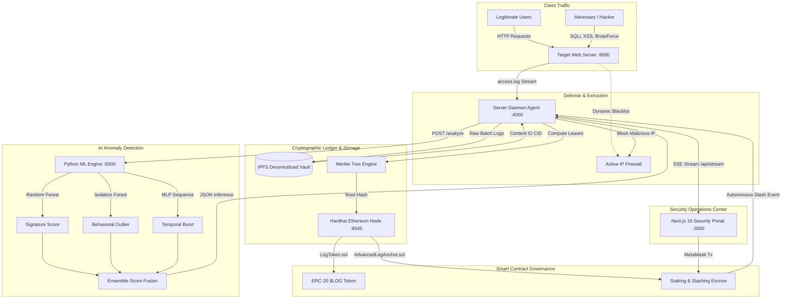

<div align="center">

# 🛡️ BLAD: Blockchain-Anchored Log Anomaly Detection
### *Next-Gen Decentralized SIEM, Cryptographic Chain-of-Custody & Autonomous Smart Contract Slashing*

[](LICENSE)
[](https://nextjs.org/)
[](https://react.dev/)
[](https://soliditylang.org/)
[](https://hardhat.org/)
[](https://www.python.org/)
[](https://ipfs.tech/)
[](https://www.docker.com/)

<br/>

[Architecture](#-system-architecture) •
[Key Features](#-key-features) •
[ML Ensemble](#-tri-model-machine-learning-engine) •
[Smart Contracts](#-smart-contracts--tokenomics) •
[Quick Start](#-quick-start) •
[Attack Simulation](#-simulating-cyber-attacks) •
[Forensic Verification](#-cryptographic-chain-of-custody)

</div>

---

## 📌 Executive Summary

Modern Security Information and Event Management (SIEM) systems suffer from a single point of failure: **centralized log stores are vulnerable to insider manipulation, root-access tampering, and log-deletion attacks**. 

**BLAD** (*Blockchain Log Anomaly Detection*) solves this by anchoring audit logs in cryptographic Merkle trees, preserving immutable raw evidence on **IPFS**, and deploying **Ethereum smart contracts** that autonomously penalize malicious or compromised nodes through **economic stake slashing** with zero human intermediary delays.

```
Incoming Web Traffic ──► Protected Service ──► Live Log Stream
                                                     │
                             ┌───────────────────────┴───────────────────────┐
                             ▼                                               ▼
               [ Tri-Model AI/ML Engine ]                       [ Cryptographic Hash Engine ]
               • Random Forest (Signatures)                     • Keccak256 Leaf Hashing
               • Isolation Forest (Behavioral)                  • OpenZeppelin Merkle Tree
               • MLP Sequence (Temporal Bursts)                 • IPFS Decentralized Vault (CID)
                             │                                               │
                             └───────────────────────┬───────────────────────┘
                                                     ▼
                                     [ Ethereum Smart Contract Layer ]
                                     • Anchors Merkle Root On-Chain
                                     • Verifies Cryptographic Proofs
                                     • Executes Stake Slashing (500 $LOG)
                                     • Pays Auditor Bounty (100 $LOG)
                                     • Signals Autonomous Firewall Drop
```

---

## ⚡ Traditional SIEM vs. BLAD Architecture

| Feature | Traditional Centralized SIEM (Splunk/ELK) | BLAD Decentralized Defense |
| :--- | :--- | :--- |
| **Log Immutability** | ❌ Mutable; root administrator can rewrite or erase history | ✅ **Mathematically Immutable** via Ethereum blockchain & Keccak256 |
| **Tamper Detection** | ❌ Dependent on trust in internal administrators | ✅ **Cryptographic Verification** via Merkle Multi-Proofs |
| **Detection Engine** | ⚠️ Static heuristic regex rules & simple thresholds | ✅ **Tri-Model Ensemble**: Supervised + Unsupervised + Sequence AI |
| **Incident Response**| ⏱️ Manual SOC alerts, hours-long ticket triage | ⚡ **Automated On-Chain Slashing & Dynamic IP Blacklisting** |
| **Evidence Storage** | 📁 Centralized database servers (SQL / Elastic) | 🌐 **Content-Addressed Decentralized Storage (IPFS)** |
| **Legal Admissibility** | ⚠️ Chain-of-custody easily contested in court | 📜 **ISO/IEC 27037 Forensic Certifications with verifiable CIDs** |

---

## 🔬 System Architecture

The BLAD monorepo orchestrates five purpose-built microservices communicating over resilient REST, WebSocket, and Server-Sent Event (SSE) pipelines:



---

## 🧠 Tri-Model Machine Learning Engine

BLAD combines three complementary machine learning paradigms to maintain high precision while eliminating single-model blindspots:

```
                          ┌────────────────────────┐
                          │   Log Feature Vector   │
                          └───────────┬────────────┘
                                      │
         ┌────────────────────────────┼────────────────────────────┐
         ▼                            ▼                            ▼
┌──────────────────┐        ┌──────────────────┐        ┌──────────────────┐
│  Random Forest   │        │ Isolation Forest │        │   MLP Sequence   │
│   (Supervised)   │        │  (Unsupervised)  │        │(Temporal Window) │
└────────┬─────────┘        └────────┬─────────┘        └────────┬─────────┘
         │                           │                           │
         │ P(Signature)              │ Outlier Distance          │ Sequence Burst
         ▼                           ▼                           ▼
         └────────────────────────────┬────────────────────────────┘
                                      │ Weighted Score Fusion
                                      ▼
                        [ Composite Threat Score ]
                        • Normal:     0.00 - 0.45
                        • Suspicious: 0.45 - 0.70
                        • Critical:   0.70 - 1.00
```

1. **Random Forest Classifier (Supervised)**:
   - Trained on structural characteristics: URL entropy, parameter lengths, dangerous token density (`UNION`, `SELECT`, `<script>`, `../`), payload byte volumes, and HTTP status distributions.
   - High precision detection for SQL Injection, XSS, and Path Traversal.

2. **Isolation Forest (Unsupervised Baseline)**:
   - Constructs randomized isolation trees to isolate anomalous data points with minimal splits.
   - Identifies zero-day anomalies, novel exploit patterns, and behavioral traffic spikes without requiring pre-labeled training data.

3. **Multi-Layer Perceptron Temporal Sequence Model**:
   - Analyzes rolling sliding windows (10–30s) per IP address to detect distributed slow-and-low brute force attacks and credential stuffing that evade per-request inspection.

---

## 🔐 Cryptographic Chain-of-Custody

```
Log Entry 0 ──► Keccak256 ──► Leaf L0 ──┐
                                         ├──► Hash(L0 + L1) ──┐
Log Entry 1 ──► Keccak256 ──► Leaf L1 ──┘                     ├──► Merkle Root (On-Chain Anchor)
                                                              │
Log Entry 2 ──► Keccak256 ──► Leaf L2 ──┐                     │
                                         ├──► Hash(L2 + L3) ──┘
Log Entry 3 ──► Keccak256 ──► Leaf L3 ──┘
```

1. **Leaf Generation**: Every raw access log entry is hashed via Ethereum's native cryptographic primitive:
   $$\text{Leaf}_i = \text{keccak256}(\text{bytes}(\text{log\_line}_i))$$
2. **Deterministic Tree Assembly**: Leaves are paired and hashed recursively in lexicographical order (OpenZeppelin standard).
3. **Decentralized Evidence Vault**: The entire raw log batch is converted into canonical JSON and pinned to IPFS, producing a content addressable identifier (`CID`).
4. **On-Chain Anchor**: The Merkle root, timestamp, server identifier, and previous root hash are submitted to the `AdvancedLogAnchor` smart contract, establishing a cryptographically tamper-evident historical audit ledger.

---

## 🪙 Smart Contracts & Tokenomics

The smart contract layer enforces economic security and decentralization through two smart contracts written in Solidity `0.8.20`:

### 1. `$LOG` ERC-20 Staking Token (`LogToken.sol`)
- Utility token powering validator and server staking.
- Minted on contract initialization and distributed to participating server nodes and independent security auditors.

### 2. `AdvancedLogAnchor.sol` Governance Escrow
- **Server Staking**: Edge nodes lock **500 `$LOG`** in escrow before receiving authorization to anchor log roots.
- **Root Anchoring**: Servers periodically commit `anchorHash(bytes32 _merkleRoot)` which indexes current and previous roots.
- **Proof-of-Exploit Verification & Slashing**:
  $$\text{verifyAndSlash}(server, root, proof[], maliciousLeaf)$$
  When an independent auditor identifies a malicious payload in an anchored batch:
  1. The auditor submits the cryptographic Merkle proof on-chain via MetaMask.
  2. The contract verifies that the leaf belongs to the anchored root without needing the full dataset.
  3. The contract slashes the node's **500 `$LOG`** stake:
     - **100 `$LOG`** awarded immediately to the auditor as a bounty reward.
     - Remainder locked / burned as penalty.
  4. Emits `Slashed` event triggering automatic firewall enforcement.

---

## 💻 Tech Stack

```
Frontend:           Next.js 16 (App Router) • React 19 • Lucide Icons • Recharts • Canvas-Confetti
Smart Contracts:    Solidity 0.8.20 • Hardhat • Ethers.js v6 • OpenZeppelin Contracts
Machine Learning:   Python 3.10+ • Flask • Scikit-Learn • NumPy • Pandas • Joblib
Backend & Agents:   Node.js 18+ • Express • Axios • Crypto • Server-Sent Events (SSE)
Storage:            IPFS Decentralized Gateway (Pinata Integration + Local Fallback)
DevOps:             Docker • Docker Compose • Multi-Stage Build Containers
```

---

## 🚀 Quick Start

### Prerequisites
- [Docker Desktop](https://www.docker.com/) (recommended) **OR** [Node.js 18+](https://nodejs.org/) & [Python 3.10+](https://www.python.org/)
- [MetaMask Browser Extension](https://metamask.io/)

---

### Option A: 1-Click Launch (Docker Compose)

Clone the repository and run the pre-configured container suite:

```bash
git clone https://github.com/aritrasphs16-design/blockchain-log-anomaly-detection.git
cd blockchain-log-anomaly-detection
docker compose up --build -d
```

To gracefully stop all containers:
```bash
docker compose down
```

---

### Option B: Local Windows Development Launcher

For native execution with live file watchers:

1. Double-click **`demo_start.bat`** (or run via terminal):
   ```cmd
   demo_start.bat
   ```
2. The script will automatically:
   - Spin up the local Hardhat Ethereum node (`:8545`)
   - Compile and deploy smart contracts & mint initial tokens
   - Start the Python ML Engine (`:5000`)
   - Launch the protected target website (`:8080`)
   - Start the Node.js Server Daemon Agent (`:4000`)
   - Boot the Next.js Cyber Defense Dashboard (`:3000`)

---

## 🌐 Port Mapping & Endpoints

| Service | Port | Description | Health Check |
| :--- | :--- | :--- | :--- |
| **Frontend Portal** | `http://localhost:3000` | Security Command Center & Slashing UI | `GET /api/health` |
| **Target Application** | `http://localhost:8080` | Protected web service with attack simulator | `GET /` |
| **Server Daemon** | `http://localhost:4000` | Merkle builder, IPFS archiver & SSE stream | `GET /api/status` |
| **ML Engine** | `http://localhost:5000` | Tri-model real-time inference engine | `POST /analyze` |
| **Ethereum RPC** | `http://localhost:8545` | Local testnet blockchain (Chain ID: `31337`) | JSON-RPC |

---

## 🦊 MetaMask Configuration

To interact with the smart contracts on your local network:

1. Open **MetaMask** ➡️ **Add Network** ➡️ **Add a network manually**:
   - **Network Name**: `BLAD Hardhat Localnet`
   - **New RPC URL**: `http://127.0.0.1:8545`
   - **Chain ID**: `31337`
   - **Currency Symbol**: `ETH`
2. **Import Demo Account**:
   - Import default auditor account private key for testing:
     `0x5de4111afa1a4b94908f83103eb2f95408e82d334575c34e8976b7e6417730e6` *(Hardhat Account #2)*
3. Use the **+ Faucet** button in the dashboard top bar to receive demo gas ETH and `$LOG` tokens.

---

## ⚔️ Simulating Cyber Attacks

You can trigger automated attack vectors directly from the UI or via the CLI attack simulator:

```bash
# In target_website directory:
node attack_simulator.js sqli           # Simulates SQL Injection attack
node attack_simulator.js xss            # Simulates Cross-Site Scripting (XSS)
node attack_simulator.js traversal      # Simulates Path Traversal (/etc/passwd)
node attack_simulator.js bruteforce     # Simulates Fast Credential Stuffing
node attack_simulator.js slowbruteforce # Simulates Low-and-Slow evasive attack
node attack_simulator.js all            # Executes full automated attack suite
```

Watch the live reaction across the platform:
- The **Cyber Threat Radar** intercepts the attack vector in real-time.
- The **ML Tri-Model Engine** computes threat probabilities and categorizes the vector.
- The **Server Agent** bundles the log into an IPFS batch and commits the Merkle Root on-chain.
- The **Audit Console** enables single-click cryptographic proof generation and slashing.

---

## 📂 Repository Organization

```
blockchain-log-anomaly-detection/
├── contracts_layer/             # Smart Contract Ecosystem
│   ├── contracts/
│   │   ├── AdvancedLogAnchor.sol # Merkle proof verification & stake slashing
│   │   └── LogToken.sol          # ERC-20 governance & auditor reward token
│   ├── scripts/deploy.cjs       # Automated deployment & ABI exporter
│   └── hardhat.config.js        # Hardhat EVM compiler configuration
├── frontend/                    # Next.js 16 Security Operations Center
│   ├── app/
│   │   ├── page.js              # Command Center Overview & Threat Radar
│   │   ├── ml/page.jsx          # ML Tri-Model Analytics & Feature Breakdown
│   │   ├── verification/page.jsx# Interactive Merkle Tree Tamper Verifier
│   │   ├── audit/page.jsx       # Slashing Terminal & Live Event Stream
│   │   ├── evidence/page.jsx    # IPFS Decentralized Evidence Vault
│   │   ├── blockchain/page.jsx  # Ledger Explorer & Block Visualizer
│   │   └── servers/page.jsx     # Node Staking & Slashing Status
│   ├── components/              # AppShell, Visualizers, SSE Provider, UI
│   └── public/                  # Static brand assets and icons
├── ml_engine/                   # AI Anomaly Detection Service
│   ├── ml_detector.py           # Random Forest, Isolation Forest & MLP pipeline
│   ├── generate_dataset.py      # Synthetic web log corpus generator
│   └── requirements.txt         # Scikit-learn, Flask, Pandas dependencies
├── server_agent/                # Autonomous Edge Daemon
│   ├── staking_monitor.js       # Log watcher, Merkle builder, on-chain committer
│   ├── ipfs_uploader.js         # IPFS gateway archiver & CID generator
│   └── hacker_script.js         # Automated multi-phase penetration testing script
├── target_website/              # Protected Web Application
│   ├── server.js                # Express REST API & Dynamic IP Firewall
│   └── attack_simulator.js      # CLI payload injection simulator
├── docker-compose.yml           # Unified multi-service orchestration
├── demo_start.bat               # Windows native parallel launcher
└── README.md                    # Platform documentation
```

---

## 🔒 Security & Disclosure Policy

This repository is maintained with strict security practices:
- **No Private Keys Committed**: Contract configuration files only distribute public addresses and ABIs. Testing accounts use standard, well-documented Hardhat sandbox accounts.
- **Zero-Trust Log Integrity**: Client devices never submit raw assertions; all forensic proof is mathematically verified through Keccak256 Merkle proofs on Ethereum.
- **Responsible Disclosure**: To report security vulnerabilities in the contract architecture or daemon agent, please open a GitHub Security Advisory.

---

<div align="center">

**Developed with ❤️ for Advanced Blockchain Architecture & Cyber Defense Research**

[](https://github.com/aritrasphs16-design/blockchain-log-anomaly-detection)
[](https://github.com/aritrasphs16-design/blockchain-log-anomaly-detection)

</div>
